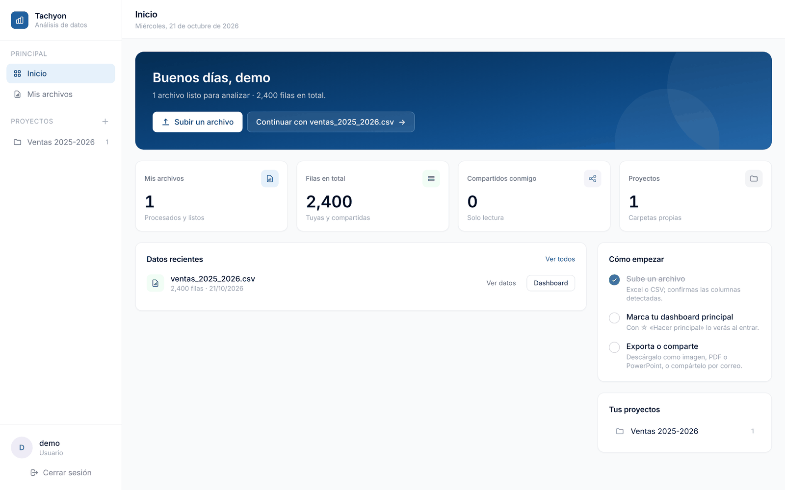
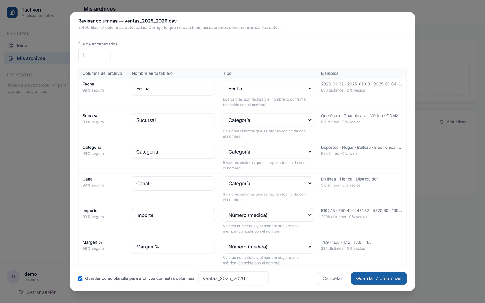
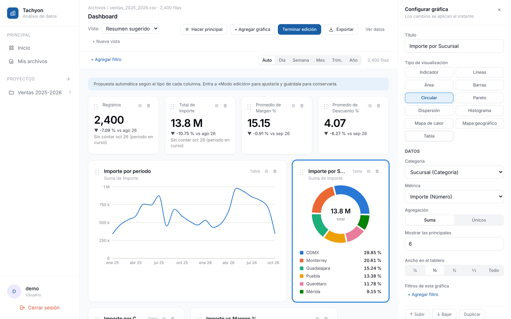
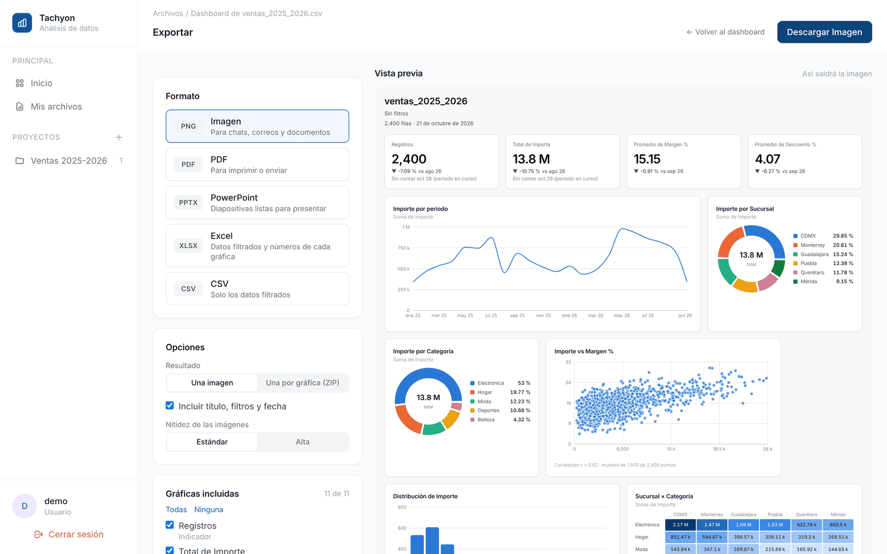
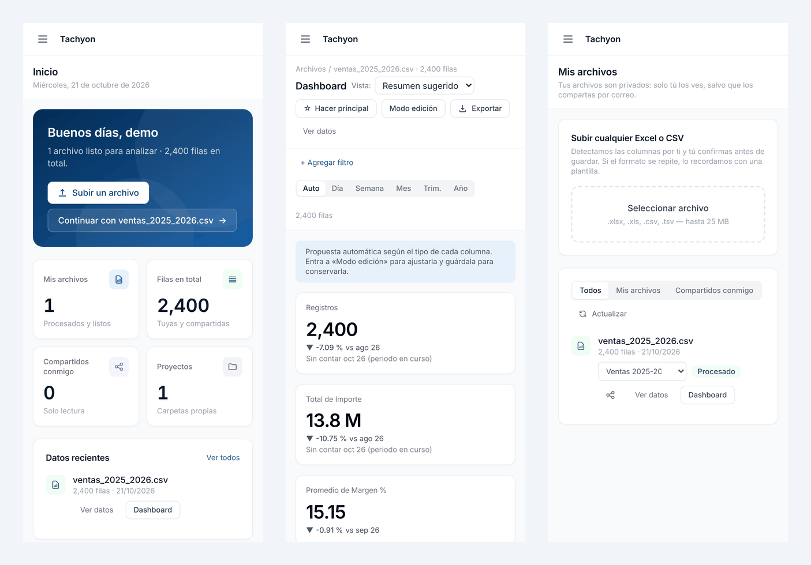

# Tachyon

**De tu Excel a un dashboard, sin fórmulas ni configuraciones.**

Plataforma web para analizar cualquier archivo de Excel o CSV: lo subes, el sistema entiende tus columnas y en segundos tienes un tablero interactivo listo para explorar, compartir y exportar.

 

Dashboard generado automáticamente a partir de un CSV de ejemplo.

 

## Qué es

Tachyon nace de una idea sencilla: la mayoría de la gente ya tiene sus datos en una hoja de cálculo, pero convertirlos en algo que se pueda leer de un vistazo requiere fórmulas, tablas dinámicas o herramientas de BI pensadas para especialistas.

Aquí el proceso es el contrario. Subes el archivo, confirmas lo que el sistema detectó y obtienes un dashboard que luego puedes ajustar a tu gusto. No importa de qué trate el archivo: ventas, inventarios, encuestas, producción o finanzas.

## Lo que hace

- **Entiende tus columnas solo.** Detecta fechas, categorías, medidas y datos geográficos, y te muestra su propuesta para que la confirmes o corrijas antes de guardar.
- **Aprende de tus archivos.** Si vuelves a subir un archivo con las mismas columnas, lo reconoce y se salta la revisión.
- **Propone un dashboard.** Indicadores con comparación contra el periodo anterior, tendencias, distribuciones y relaciones entre variables, elegidos según el tipo de cada columna.
- **Se edita a tu medida.** Once tipos de gráfica (incluido mapa geográfico), filtros globales y por gráfica, varias vistas guardadas y reordenamiento arrastrando.
- **Exporta lo que ves.** Imagen, PDF, PowerPoint, Excel o CSV, con vista previa antes de descargar.
- **Comparte con control.** Cada usuario ve únicamente sus datos; puede compartir un archivo por correo en modo solo lectura.
- **Se organiza en proyectos.** Carpetas personales para agrupar archivos relacionados.
- **Funciona en el celular.** La interfaz se adapta a pantallas pequeñas.

## Recorrido

<table>
<tr>
<td width="50%"> <b>Inicio</b> Resumen de tu actividad, accesos rápidos y guía para empezar.</td>
<td width="50%"> <b>Revisión de columnas</b> El sistema propone el tipo de cada columna y explica por qué.</td>
</tr>
<tr>
<td width="50%"> <b>Modo edición</b> Cambia el tipo de gráfica, la métrica y los filtros al instante.</td>
<td width="50%"> <b>Exportación</b> Vista previa y descarga en varios formatos.</td>
</tr>
</table>

Versión móvil.

## Tecnologías

| Capa | Herramientas |
|---|---|
| Interfaz | React, Vite, Tailwind CSS, Recharts, Leaflet |
| API | Python, FastAPI, pandas |
| Datos | PostgreSQL y almacenamiento en formato columnar (Parquet) |
| Calidad | Pruebas automatizadas del backend e integración continua |

## Estado del proyecto

Proyecto en desarrollo activo. Las próximas etapas se enfocan en más tipos de análisis, plantillas de dashboard reutilizables y mejoras de rendimiento con archivos grandes.

---

Las capturas usan datos de ejemplo generados para esta documentación.
