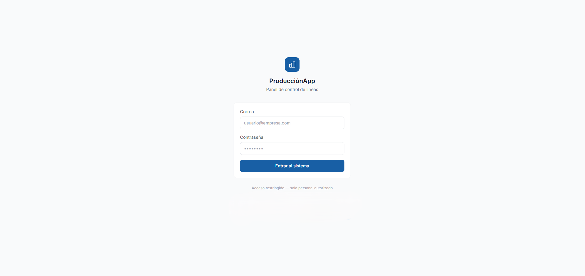
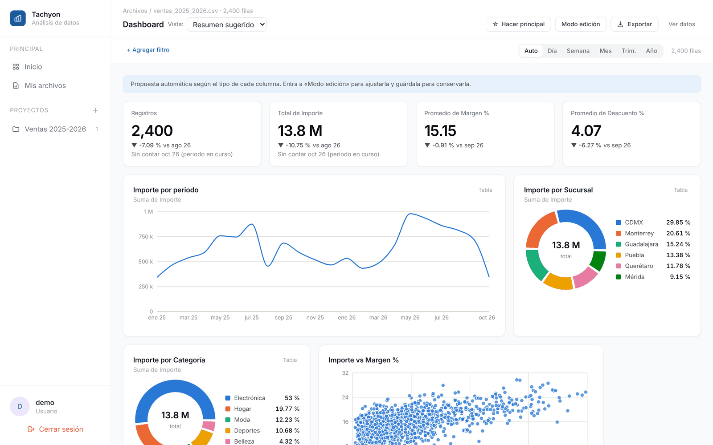
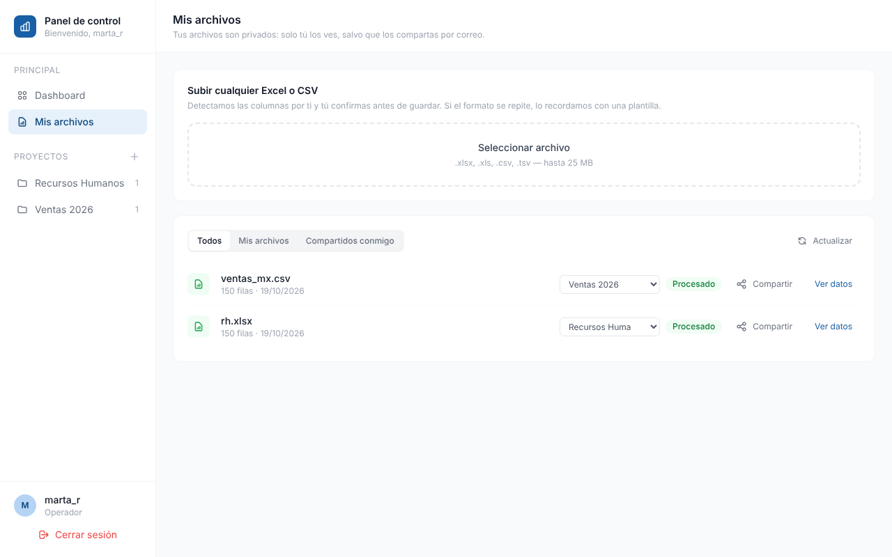

# Project_Tachyon

Aplicación web para monitoreo y gestión de líneas de producción.

Incluye autenticación de usuarios, dashboard con métricas visuales y módulo de carga de archivos Excel preparado para futuras funcionalidades de análisis y procesamiento de datos.

---

## 🚀 Tecnologías utilizadas

### Backend
- FastAPI
- SQLite
- Pandas
- Python 3.10+

### Frontend
- React
- Vite
- Tailwind CSS
- Axios
- Node.js 18+

---

## 📋 Requisitos

Antes de ejecutar el proyecto asegúrate de tener instalado:

- Python 3.10 o superior
- Node.js 18 o superior
- npm

---

### 2. Configurar el Backend

```bash
cd backend
pip install -r requirements.txt
python main.py
```

El backend estará disponible en:

```text
http://localhost:8000
```

Documentación automática de la API:

```text
http://localhost:8000/docs
```

---

### 3. Configurar el Frontend

Abrir una nueva terminal:

```bash
cd frontend
npm install
npm run dev
```

La aplicación estará disponible en:

```text
http://localhost:5173
```

---

## ✨ Funcionalidades actuales

- Inicio de sesión de usuarios.
- Dashboard con indicadores visuales.
- Métricas por día, semana y mes.
- Carga de archivos Excel.
- API REST desarrollada con FastAPI.
- Interfaz desarrollada con React y Tailwind CSS.

---

## 📁 Estructura del proyecto

```text
produccion-app/
│
├── backend/
│   ├── main.py
│   ├── excel_parser.py
│   ├── requirements.txt
│   └── produccion.db (se genera automáticamente)
│
├── frontend/
│   ├── src/
│   │   ├── pages/
│   │   ├── components/
│   │   ├── context/
│   │   ├── services/
│   │   └── index.css
│   │
│   ├── package.json
│   ├── vite.config.js
│   ├── tailwind.config.js
│   └── postcss.config.js
│
└── README.md
```

---

## Próximas funcionalidades

- [x] Procesamiento automático de archivos Excel.
- [ ] Generación de reportes PDF.
- [ ] Gestión avanzada de usuarios.
- [ ] Filtros por rango de fechas.
- [ ] Indicadores por línea de producción.
- [ ] Exportación de métricas.

---

## 📝 Notas

- La base de datos SQLite se crea automáticamente durante la primera ejecución del backend.
- Los archivos Excel cargados actualmente se almacenan para futuras funcionalidades de procesamiento.
- Este proyecto se encuentra en desarrollo y puede recibir cambios en la estructura y funcionalidades.

---

## 👨‍💻 Autor

Desarrollado como proyecto de gestión y monitoreo de producción


## 🗺️ Imagenes

## Login



## Dashboard Principal



## Módulo de Carga de Excel



## Variables de entorno

**Backend (Render u otro host)**

| Variable | Para qué sirve |
|---|---|
| `SECRET_KEY` | Clave para firmar los tokens JWT (mínimo 32 caracteres). **Obligatoria en producción.** |
| `ALLOWED_ORIGINS` | URL(s) del frontend permitidas por CORS, separadas por coma. Ej: `https://tachyon.pages.dev` |
| `SEED_DEMO_USERS` | `0` para no crear los usuarios de demostración (por defecto se crean). |
| `ADMIN_EMAIL` / `ADMIN_PASSWORD` | Si se definen, crean el usuario administrador inicial. |

**Frontend (build)**

| Variable | Para qué sirve |
|---|---|
| `VITE_API_URL` | URL del backend. En desarrollo usa `http://localhost:8000` por defecto. |
| `VITE_BASE` | Solo si se publica en una subcarpeta (ej. `/Project_tachyon/`). Normalmente vacío. |

## Usuarios, privacidad y compartir

- **Cuentas:** el administrador crea cuentas desde *Usuarios* (correo + contraseña temporal). En su primer ingreso, cada persona elige su **nombre de usuario** (único, de 3 a 20 caracteres, no se cambia después).
- **Privacidad:** cada archivo (y lo que se calcula de él en el dashboard) es solo de quien lo subió. Ni el administrador ve los archivos de los demás.
- **Compartir:** el dueño puede compartir un archivo por correo electrónico (solo lectura). Si la persona aún no tiene cuenta, lo verá cuando entre con ese correo. Se puede dejar de compartir en cualquier momento.
